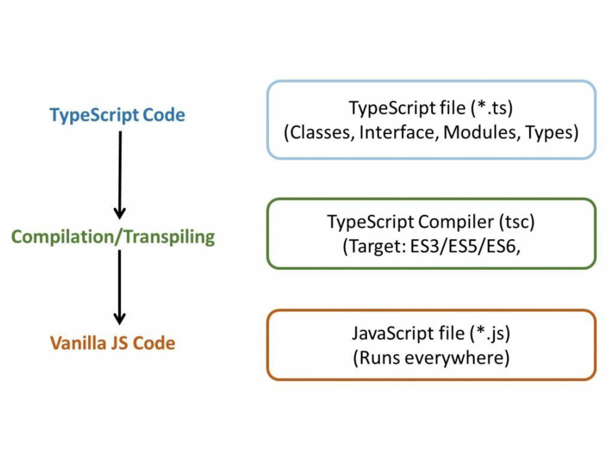

# 05 · El compilador de TypeScript

> **Sección:** Introducción a TypeScript · **Duración:** 12:51 min

## Notas

### Compilar vs. transpilar

- **Compilar:** convertir código fuente en código máquina, que es de más bajo nivel.
- **Transpilar:** convertir código fuente en otro código fuente de un nivel parecido. Es lo que hace TypeScript: convierte `.ts` en `.js`.

### Por qué hay que transpilar

Primero usamos TypeScript para el análisis de código estático. Pero Node y el navegador no ejecutan TypeScript, así que se hace un proceso de transpilación a JavaScript para que puedan entenderlo y ejecutarlo.

Todo esto sirve a la esencia de TypeScript: encontrar los errores antes de ejecutar.



1. **Código TypeScript** (`*.ts`): clases, interfaces, módulos y tipos.
2. **Compilador de TypeScript** (`tsc`): transpila según el `target` elegido.
3. **Código JavaScript** (`*.js`): corre en cualquier lugar.

Los tipos solo existen durante el análisis: al transpilar se eliminan y el `.js` queda como JavaScript normal.

### Comandos

```bash
# Transpilar un archivo (genera el .js junto al .ts)
pnpm tsc archivo.ts

# Elegir la versión de JavaScript de salida
pnpm tsc archivo.ts --target es6

# Enviar el resultado a otra carpeta
pnpm tsc archivo.ts --outDir dist
```

`--target` define a qué versión de JavaScript se transpila. Mientras más antigua sea la versión, más cambios hace `tsc` para que el código funcione en entornos viejos; por ejemplo, con `es5` convierte `const` en `var`.

### Diferencias con el curso (TypeScript 7)

- **`--target`:** en el curso se prueba con `es3`, `es5` y `es6`. En las versiones actuales `es3` ya no existe y `es5` está obsoleto; lo recomendable es usar `es2015` (equivale a `es6`) o una versión más reciente.
- **Error `Cannot redeclare block-scoped variable`:** si compilo sin `--outDir`, el `.js` queda junto al `.ts`. Como ninguno de los dos tiene `import` ni `export`, ambos son *scripts* y comparten el mismo espacio global, así que TypeScript ve la misma variable declarada dos veces. Se evita compilando a `dist` con `--outDir dist`, y en la clase 06 queda resuelto con `"moduleDetection": "force"` en el `tsconfig.json`.

## Código

- [transpilacion-l.ts](./transpilacion-l.ts): ejemplo mínimo para ver la transpilación. Este es el `.js` que genera:

  ```js
  "use strict";
  const myName = 'Manuel';
  console.log(myName);
  ```

- [transpilacion-ll.ts](./transpilacion-ll.ts): el demo de la clase 04 pasado a TypeScript, con los productos tipados y corregidos los errores que marcaba `//@ts-check`. El `for` con índice se cambió por `for...of` por la opción `noUncheckedIndexedAccess` (ver clase 06).
